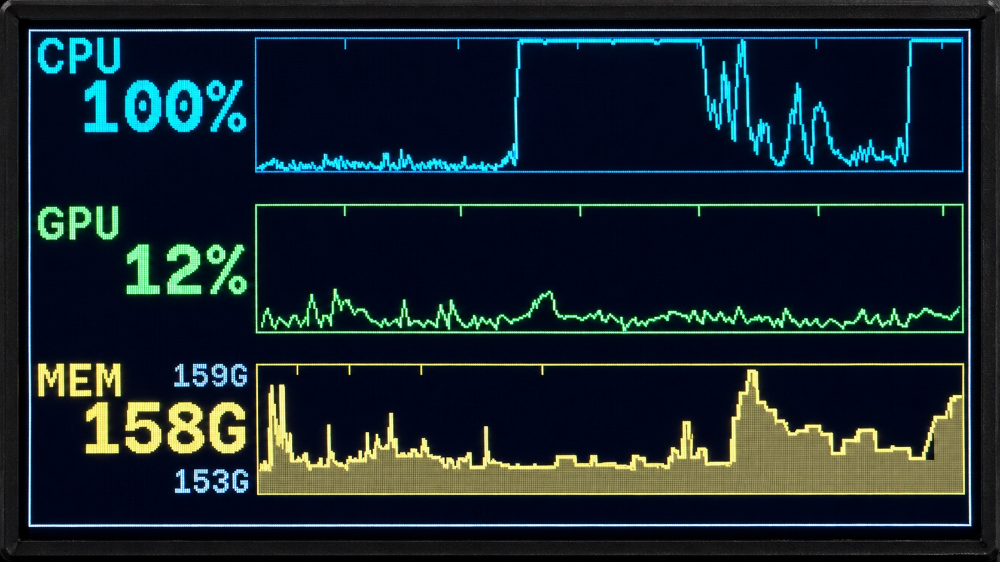

# Tach

Tach is a small external display that shows live CPU, GPU and memory use of a
Mac. It is a Raspberry Pi Pico 2 with an RA8875 driver board and a 4.3"
480×272 TFT, on one USB cable. The firmware is Rust. The main use is to
monitor the Mac while it runs local LLMs.



Each row has a big number and a chart. The display draws 30 frames each
second, and the charts travel smoothly at 12 pixels each second:

- The CPU and GPU charts show the last 32 seconds. Their numbers are the mean
  of the last second.
- The MEM chart shows the last 5 minutes on a compressed time axis. Its right
  edge travels at the same speed as the other charts. Its scale zooms to the
  data, and the limits show at the left of the chart. Memory is "Memory Used",
  the same value as in Activity Monitor.
- A row that gets no new data for 5 seconds shows "--".

The design is in [docs/device-v2.md](docs/device-v2.md), with the decisions in
[docs/adr/](docs/adr/) and the terms in [GLOSSARY.md](GLOSSARY.md).

The first version ran in CircuitPython on an Adafruit PyPortal. It is retired:
its code and design notes are no longer in this repository. The reasons for the
replacement are in
[docs/adr/0001-rp2350-and-rust-for-the-device-firmware.md](docs/adr/0001-rp2350-and-rust-for-the-device-firmware.md).

## Files

| Path | Where it runs | What it does |
|---|---|---|
| `device/` | Pico 2 | Rust firmware. Asks the Mac for one sample each frame and draws the display. |
| `tach-sender.py` | Mac | Reads CPU, GPU and memory data, and answers each request from the device. |
| `launchd/` | Mac | Starts `tach-sender.py` when you log in. |
| `fonts/` | Mac (build) | The fonts, as BDF files. The firmware build bakes them into the image. |

## Hardware

| Part | Notes |
|---|---|
| Raspberry Pi Pico 2 (RP2350) | Not the Pico 2 W. |
| Adafruit RA8875 driver board (PID 1590) | Rev E. |
| 4.3" 480×272 40-pin TFT | On the driver board's FPC connector. |
| 10 kΩ resistor | Pull-up on CS. |
| Raspberry Pi Debug Probe | To flash the firmware and read its log. |

The wiring, the checks before power and the SPI limits are in
[device/WIRING.md](device/WIRING.md).

## Requirements

- A Mac with Apple Silicon. The script uses `macmon` for the GPU, which does
  not work on Intel Macs.
- [Homebrew](https://brew.sh) and [uv](https://docs.astral.sh/uv/).
- Python 3.11 or later. You do not have to install it: `uv sync` gets the
  version in `.python-version`. The `python3` from Apple's command line
  tools is 3.9, which is too old.
- [rustup](https://rustup.rs). Do not also install Homebrew's `rust`: its
  `cargo` hides rustup's and has no embedded targets.

## Set up the Mac

```sh
git clone https://github.com/PeteRichardson/tach.git
cd tach
brew install macmon probe-rs-tools
uv sync
```

`uv sync` makes `.venv` with `pyserial`. The script does not need `sudo`.

## Flash the device

Connect the debug probe to the Pico 2 (SWDIO GP20, SWCLK GP21, GND), and
connect the Pico 2 USB port to the Mac. Then:

```sh
cd device
cargo run --release
```

`device/rust-toolchain.toml` makes rustup install the RP2350 target the first
time. `cargo run` flashes the image with `probe-rs` and then shows the device
log. The log line `fps ...` gives the frame rate and the draw time each second.
Push Ctrl-C to stop the log. The device continues to run.

## Run

```sh
uv run tach-sender.py
```

The script finds the device on USB by its product name, "tach device". If the
device disconnects, the script waits and connects again. Push Ctrl-C to stop
it.

| Option | What it does |
|---|---|
| `--stdout` | Print the data lines. Do not use USB. |

## Start at login

A `launchd` agent starts `tach-sender.py` when you log in. If the script
stops, launchd starts it again after 10 seconds.

```sh
launchd/install.sh             # install (or reinstall) and start the agent
launchd/install.sh status      # show whether the agent runs
launchd/install.sh uninstall   # stop and remove the agent
```

The script uses the Python in `.venv`, so run `uv sync` first. Run
`install.sh` again if you move the project folder or reinstall macmon. The log
is in `~/Library/Logs/tach-sender.log`.

When the agent runs, do not also start `uv run tach-sender.py`. Only one
program can use the device.

## Development

Run these for every change:

```sh
cargo test --manifest-path device/host-tests/Cargo.toml   # firmware tests, on the Mac
uv run pytest                                             # tach-sender.py tests
uv run ruff check                                         # Python lint
```

Run the firmware tests from the repository root, so that
`device/.cargo/config.toml` does not force the RP2350 target. The tests need
no device attached.

GitHub Actions runs all three on every pull request and on every merge to
`main` (`.github/workflows/ci.yml`).

The bring-up log, with the measurements and the problems found on the
hardware, is in [device/BRINGUP.md](device/BRINGUP.md).
`cargo run --release --bin ra8875_bringup` runs a test of each wire and of
the SPI link.

## Troubleshooting

| Problem | What to do |
|---|---|
| A row shows "--". | That row got no new data for 5 seconds. If only GPU shows "--", macmon stopped. If all rows do, make sure that `tach-sender.py` runs. |
| The charts are blank. | The device got no reply from the Mac for 5 seconds. Make sure that `tach-sender.py` runs, and that no other program uses the device port. |
| The panel stays dark. | Look at the FPC ribbon direction in [device/WIRING.md](device/WIRING.md), "Checks before power". |
| Random shapes on the panel. | SPI writes are lost. Look at the SPI settings in [device/WIRING.md](device/WIRING.md). |
| The MEM chart does not show the full size of a model. | The LLM runtime maps the model file into memory (mmap). macOS counts those file-backed pages in `external_page_count`, and `tach-sender.py` follows Activity Monitor in excluding them from "Memory Used". See [docs/device-v2.md](docs/device-v2.md), "Mac-side sources". |

## License

MIT. See [LICENSE](LICENSE).
