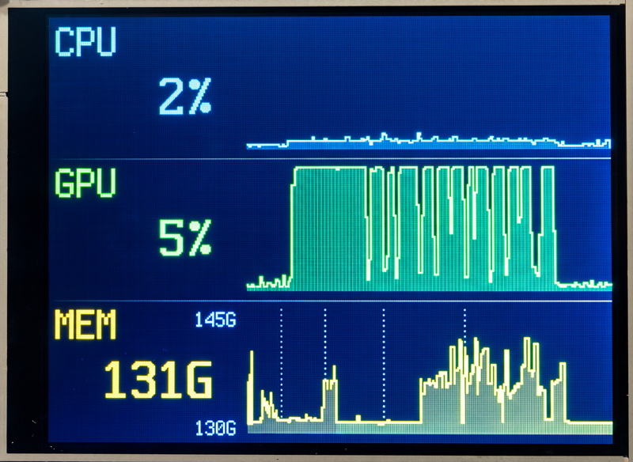

# Tach

Tach is a small external display that shows live CPU, GPU and memory use of a
Mac. It uses an Adafruit PyPortal and one USB cable. The main use is to monitor
the Mac while it runs local LLMs.



Each row has a big number and a chart. The CPU and GPU charts show
approximately the last 1.7 minutes. The MEM chart shows the last 5 minutes on
a compressed time axis, and its scale zooms to the data. The
display updates two times each second. Memory is "Memory Used", the same value
as in Activity Monitor.

The full design is in [design.md](design.md).

## Files

| File | Where it runs | What it does |
|---|---|---|
| `boot.py` | PyPortal | Enables a second USB serial channel for Tach data. |
| `code.py` | PyPortal | Reads the data and shows the display. |
| `tach-sender.py` | Mac | Reads CPU, GPU and memory data. Sends one line each 0.5 seconds to the PyPortal, and answers each pull from the v2 device (`device/`). |

## Requirements

- A Mac with Apple Silicon. The script uses `macmon`, which does not work on Intel Macs.
- An Adafruit PyPortal with CircuitPython 9 or later.
- [Homebrew](https://brew.sh) and [uv](https://docs.astral.sh/uv/).

## Set up the Mac

```sh
git clone https://github.com/PeteRichardson/tach.git
cd tach
brew install macmon
uv sync
```

`uv sync` makes `.venv` with `pyserial`, and `circup` for the device libraries.
The script does not need `sudo`.

## Set up the PyPortal

1. **Update the firmware.** Look at the first line of `CIRCUITPY/boot_out.txt`.
   If the version is older than 9, install the latest stable `.uf2` file from
   <https://circuitpython.org/board/pyportal/>. To install it, double-click
   RESET to get the `PORTALBOOT` drive, then drag the file onto the drive.

   An old board can also have an old bootloader. Look at
   `PORTALBOOT/INFO_UF2.TXT`. If the bootloader is older than v3, first install
   `update-bootloader-pyportal_m4-<version>.uf2` from
   <https://github.com/adafruit/uf2-samdx1/releases>. Use the `.uf2` file, not
   the `.bin` file. Do not disconnect the board while it updates.

2. **Install the libraries.** If you updated from an old CircuitPython version,
   first delete `CIRCUITPY/lib/`. Old `.mpy` files do not work on new versions.

   ```sh
   uv run circup install adafruit_display_text adafruit_bitmap_font
   ```

3. **Add a font (optional).** Put a BDF or PCF font, approximately 36 px high,
   at `CIRCUITPY/fonts/tach-36.bdf`. If there is no font, the device uses the
   scaled built-in font, which is blocky. To make a BDF font from a TTF font,
   see Adafruit's guide "Custom Fonts for CircuitPython Displays".

4. **Copy the code.** Copy `boot.py` and `code.py` to `CIRCUITPY`.

5. **Push RESET one time.** `boot.py` takes effect only after a hard reset.
   Then this command must show two ports for the PyPortal:

   ```sh
   ls /dev/cu.usbmodem*
   ```

## Run

```sh
uv run tach-sender.py
```

The script finds the PyPortal data port automatically. If the device
disconnects, the script waits and connects again. Push Ctrl-C to stop it.

| Option | What it does |
|---|---|
| `--port /dev/cu.usbmodemNNNN` | Use this port. Use it if the script selects the wrong port. |
| `--stdout` | Print the data lines. Do not use USB. |

## Start at login

A `launchd` agent starts `tach-sender.py` when you log in. If the script
stops, launchd starts it again after 10 seconds.

```sh
launchd/install.sh             # install (or reinstall) and start the agent
launchd/install.sh status      # show whether the agent runs
launchd/install.sh uninstall   # stop and remove the agent
```

The script uses the Python in `.venv`, so run `uv sync` first. Run
`install.sh` again if you move the project folder or reinstall macmon. The log
is in `~/Library/Logs/tach-sender.log`.

When the agent runs, do not also start `uv run tach-sender.py`. Only one
program can use the data port.

## Development

Set up the host tools once, then run them for every change:

```sh
uv sync             # install pytest and ruff into .venv
uv run pytest       # run the tests
uv run ruff check   # run the lint
cargo test --manifest-path device/host-tests/Cargo.toml   # run the firmware tests on the Mac
```

GitHub Actions runs both commands on every push and pull request
(`.github/workflows/ci.yml`). The tests need no device attached: `code.py`
runs against fake display modules, and the memory tests use recorded
`macmon pipe` data.

## Test the display without the Mac

In `CIRCUITPY/code.py`, set `DEMO = True`. The device then shows test data and
does not read USB. Set `DEMO = False` to use real data again.

## Troubleshooting

| Problem | What to do |
|---|---|
| The numbers are grey. | The device got no data for 5 seconds. Make sure that `tach-sender.py` runs. |
| NO FONT at the top of the screen; blocky numbers. | The big font did not load: the file is missing or damaged, or the `adafruit_bitmap_font` library in `lib/` is broken. Copy a BDF font to `/fonts/tach-36.bdf`, then push RESET. |
| `found only one Adafruit port` | `boot.py` is not on the device, or you did not push RESET after you copied it. |
| The script does not find the device. | Run `ls /dev/cu.usbmodem*`. Give the higher-numbered PyPortal port with `--port`. |
| The MEM chart does not show the full size of a model. | The LLM runtime maps the model file into memory (mmap). See design.md, section 5.1. |
| Errors on the device | Open the serial console: `screen /dev/cu.usbmodem<lower number> 115200`. To stop `screen`, push Ctrl-A, then K, then Y. |

## Message format

`tach-sender.py` sends one JSON object on each line:

```json
{"cpu":34.0,"gpu":88.0,"mem":97.4,"mem_total":128.0}
```

`cpu` and `gpu` are in %. `mem` and `mem_total` are in GB. The device ignores
keys that it does not know. See design.md, section 7.

## License

MIT. See [LICENSE](LICENSE).
