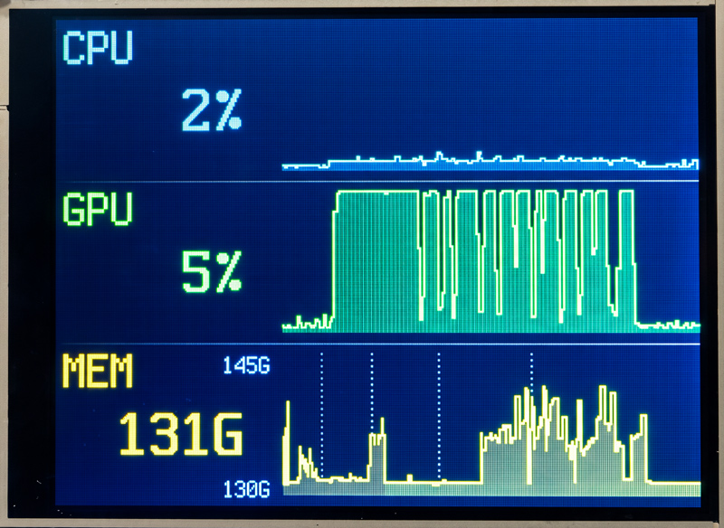

# Tach v1 — PyPortal

This is the first version of Tach. It runs in CircuitPython on an Adafruit
PyPortal. Version 2, the Rust firmware for the RA8875 panel, replaces it. See
the [main README](../README.md).



Each row has a big number and a chart. The CPU and GPU charts show
approximately the last 1.7 minutes. The MEM chart shows the last 5 minutes on
a compressed time axis, and its scale zooms to the data. The display updates
two times each second.

The design is in [design.md](design.md).

## Files

| File | Where it runs | What it does |
|---|---|---|
| `boot.py` | PyPortal | Enables a second USB serial channel for Tach data. |
| `code.py` | PyPortal | Reads the data and shows the display. |
| `../tach-sender.py` | Mac | Sends one line each 0.5 seconds to the PyPortal. The same script serves v2. |

## Requirements

- An Adafruit PyPortal with CircuitPython 9 or later.
- The Mac set-up in the [main README](../README.md#set-up-the-mac).

## Set up the PyPortal

1. **Update the firmware.** Look at the first line of `CIRCUITPY/boot_out.txt`.
   If the version is older than 9, install the latest stable `.uf2` file from
   <https://circuitpython.org/board/pyportal/>. To install it, double-click
   RESET to get the `PORTALBOOT` drive, then drag the file onto the drive.

   An old board can also have an old bootloader. Look at
   `PORTALBOOT/INFO_UF2.TXT`. If the bootloader is older than v3, first install
   `update-bootloader-pyportal_m4-<version>.uf2` from
   <https://github.com/adafruit/uf2-samdx1/releases>. Use the `.uf2` file, not
   the `.bin` file. Do not disconnect the board while it updates.

2. **Install the libraries.** If you updated from an old CircuitPython version,
   first delete `CIRCUITPY/lib/`. Old `.mpy` files do not work on new versions.
   Run this command from the repository root:

   ```sh
   uv run circup install adafruit_display_text adafruit_bitmap_font
   ```

3. **Add a font (optional).** Put a BDF or PCF font, approximately 36 px high,
   at `CIRCUITPY/fonts/tach-36.bdf`. If there is no font, the device uses the
   scaled built-in font, which is blocky. To make a BDF font from a TTF font,
   see Adafruit's guide "Custom Fonts for CircuitPython Displays".

4. **Copy the code.** Copy `pyportal/boot.py` and `pyportal/code.py` to
   `CIRCUITPY`.

5. **Push RESET one time.** `boot.py` takes effect only after a hard reset.
   Then this command must show two ports for the PyPortal:

   ```sh
   ls /dev/cu.usbmodem*
   ```

## Run

Run `tach-sender.py` as the [main README](../README.md#run) tells you. The
script finds the PyPortal data port automatically.

| Option | What it does |
|---|---|
| `--port /dev/cu.usbmodemNNNN` | Use this PyPortal port. Use it if the script selects the wrong port. |

## Test the display without the Mac

In `CIRCUITPY/code.py`, set `DEMO = True`. The device then shows test data and
does not read USB. Set `DEMO = False` to use real data again.

## Tests

`uv run pytest` from the repository root also runs the `code.py` tests. They
run `code.py` against fake display modules, so they need no PyPortal.

## Troubleshooting

| Problem | What to do |
|---|---|
| The numbers are grey. | The device got no data for 5 seconds. Make sure that `tach-sender.py` runs. |
| NO FONT at the top of the screen; blocky numbers. | The big font did not load: the file is missing or damaged, or the `adafruit_bitmap_font` library in `lib/` is broken. Copy a BDF font to `/fonts/tach-36.bdf`, then push RESET. |
| `found only one Adafruit port` | `boot.py` is not on the device, or you did not push RESET after you copied it. |
| The script does not find the device. | Run `ls /dev/cu.usbmodem*`. Give the higher-numbered PyPortal port with `--port`. |
| Errors on the device | Open the serial console: `screen /dev/cu.usbmodem<lower number> 115200`. To stop `screen`, push Ctrl-A, then K, then Y. |

## Message format

`tach-sender.py` sends one JSON object on each line:

```json
{"cpu":34.0,"gpu":88.0,"mem":97.4,"mem_total":128.0}
```

`cpu` and `gpu` are in %. `mem` and `mem_total` are in GB. The device ignores
keys that it does not know. See design.md, section 7.
